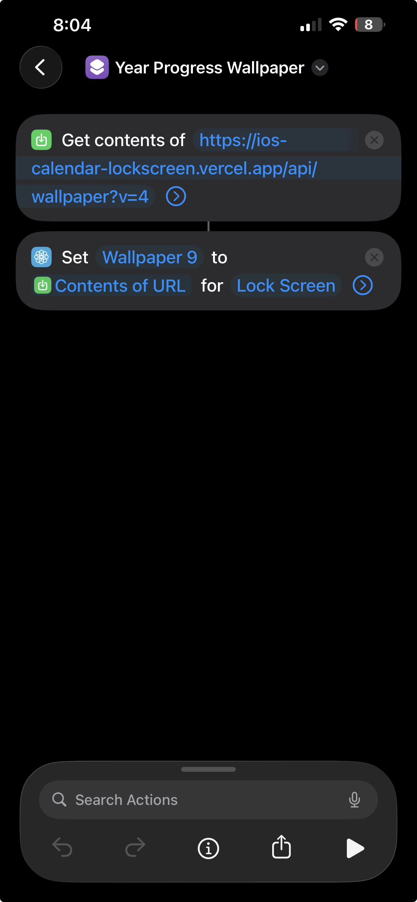

# 📅 Calendar Lockscreen

**Your calendar, dressed as your iPhone lock screen.**

[](https://www.typescriptlang.org/)
[](https://vercel.com/docs/functions/runtimes/edge)
[](https://upstash.com/)
[](https://core.telegram.org/bots)
[](https://developers.google.com/calendar/api)
[](https://opensource.org/licenses/MIT)



Calendar Lockscreen turns your calendar and upcoming events into a live wallpaper. Add events from the dashboard, Telegram, or Google Calendar—then let an iOS Shortcut put the latest view on your lock screen.

> [!NOTE]
> The app creates the wallpaper; an iOS Shortcut or automation applies it to your phone.

## ✨ What can it do?

- Choose week, month, quarter, rolling 14-day, or annual time ranges.
- Switch between calendar, agenda, countdown, progress, hybrid, and minimal presentations.
- Start from nine composed presets and calibrate spacing for a standard or large clock.
- Add, list, and delete events from Telegram.
- Import selected Google Calendar events.
- Change built-in themes or create your own.
- Keep the dashboard, bot, and wallpaper in sync through Redis.
- Give iOS a read-only wallpaper URL without exposing the management token.

## 🚀 Run it locally

```bash
npm install
cp .env.example .env
npx vercel dev --yes --listen 3000
```

Add your credentials to `.env`, then open [http://localhost:3000](http://localhost:3000).

The public wallpaper works without Redis. Personalized wallpapers and account features require Upstash Redis.

## 🔌 Connect everything

- [Telegram bot setup and commands](./docs/telegram.md)
- [Google Calendar setup](./docs/google-calendar.md)
- [Architecture and security notes](./docs/architecture-and-security.md)
- [Original project brief](./project_brief.md)

## 🧪 Check your work

```bash
npm run check
```

That one command checks formatting, linting, TypeScript, and the test suite. Tiny command, big confidence. ✅

Render deterministic full-size wallpaper previews without fetching dependencies:

```bash
npm run preview:wallpapers -- /private/tmp/calendar-lockscreen-previews
```

The command writes each preset as a 1284×2778 PNG, plus a second copy with mock clock, widget, and notification overlays. These overlays are calibration aids, not universal iPhone safe areas. Check the raw wallpaper on the target lock screen because iOS may crop or zoom an image independently of the renderer.

## 🗺️ Main routes

| Route                             | Purpose                          |
| --------------------------------- | -------------------------------- |
| `/`                               | Dashboard                        |
| `/api/wallpaper`                  | Public fallback wallpaper        |
| `/api/wallpaper?wallpaperKey=...` | Personalized read-only wallpaper |
| `/api/telegram/webhook`           | Telegram updates                 |
| `/api/google/start`               | Google Calendar connection       |

## 📄 License

MIT — build something delightful with it.
